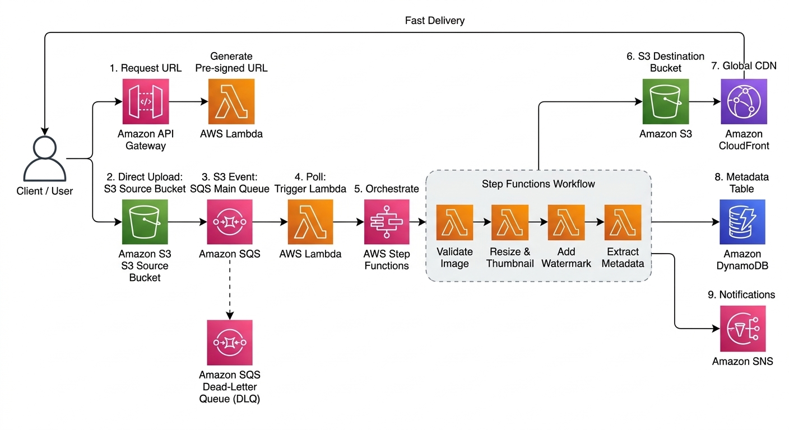

# Serverless Image Processing Pipeline (AWS)

An event-driven image processing workflow built on AWS. Users upload raw images directly to S3 using pre-signed URLs, which triggers an asynchronous pipeline to validate, resize, watermark, and store metadata without managing servers.

## Architecture

### How It Works
1. **Upload:** The client requests a temporary pre-signed URL via **API Gateway** and **Lambda**, then uploads the image directly to the **S3 Source Bucket**.
2. **Queueing:** An S3 event notification pushes the upload event to an **Amazon SQS** queue to decouple uploads from processing. Failed messages are routed to a **Dead-Letter Queue (DLQ)** after 3 retries.
3. **Processing:** A trigger Lambda pulls the message from SQS and starts an **AWS Step Functions** state machine with four sequential steps:
   - **Validate:** Checks file type (JPEG/PNG) and size limits.
   - **Resize:** Creates a web-optimized version (1280px) and a thumbnail (300px) using the `Pillow` library via a Lambda Layer.
   - **Watermark:** Adds a text watermark to the processed image.
   - **Metadata:** Extracts image dimensions and saves the record to **DynamoDB**.
4. **Delivery & Alerts:** Final images are saved to a private **S3 Destination Bucket** and served via **CloudFront** (using Origin Access Control). An **SNS** topic sends a notification once processing finishes.

## AWS Services Used
- **Storage:** Amazon S3 (Source & Destination buckets with Lifecycle rules)
- **Compute & Orchestration:** AWS Lambda (Python 3.12 + Pillow Layer), AWS Step Functions
- **Integration & Messaging:** Amazon API Gateway, Amazon SQS (Main Queue + DLQ), Amazon SNS
- **Database:** Amazon DynamoDB (On-Demand mode)
- **Networking & Security:** Amazon CloudFront (with OAC), IAM Roles (Least Privilege)

## Repository Files
- `architecture-diagram.png` - System design and data flow diagram.
- `src/lambda_processor.py` - Python handlers for generating pre-signed URLs and processing images with Pillow.
- `infrastructure/state_machine.json` - Step Functions state machine definition (ASL).

## Setup Notes
- **S3 Security:** Public access is blocked on both buckets. Uploads rely on 5-minute pre-signed URLs, and CloudFront accesses the destination bucket exclusively through Origin Access Control (OAC).
- **Cost Control:** The pipeline uses pay-per-use serverless resources. An S3 Lifecycle rule moves raw uploads to `Standard-IA` after 30 days and deletes them after 90 days.
- **IAM:** Each Lambda function uses a separate execution role restricted to its specific S3 prefix, DynamoDB table, or SNS topic.
